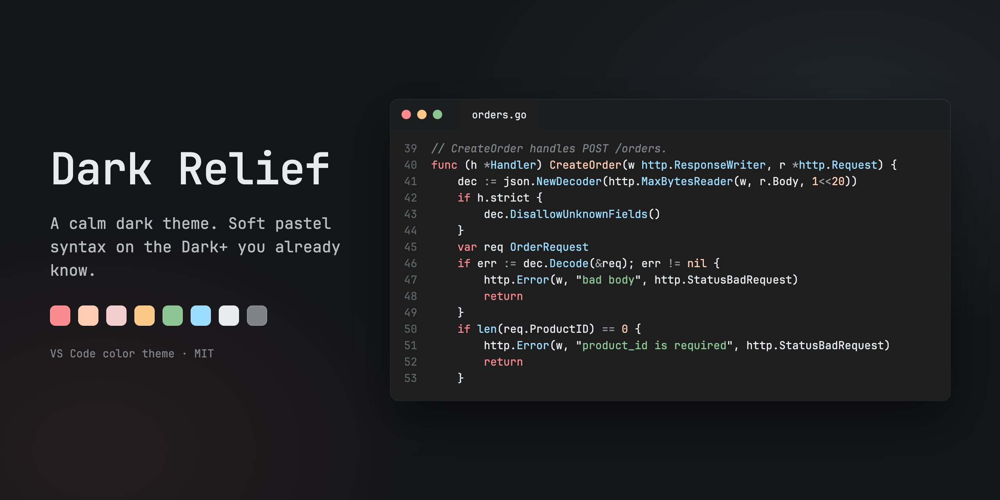
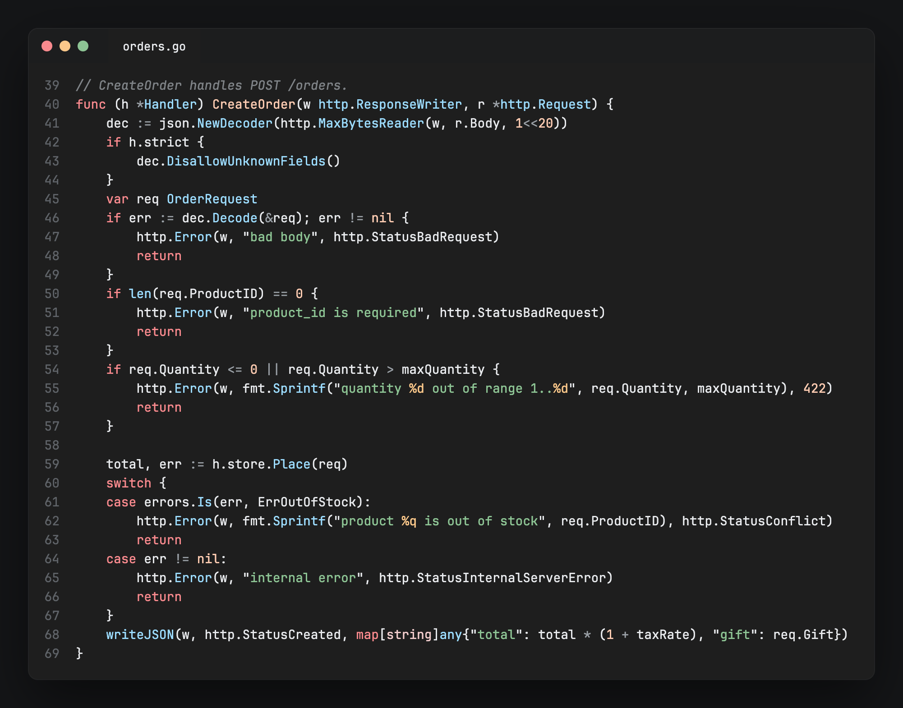
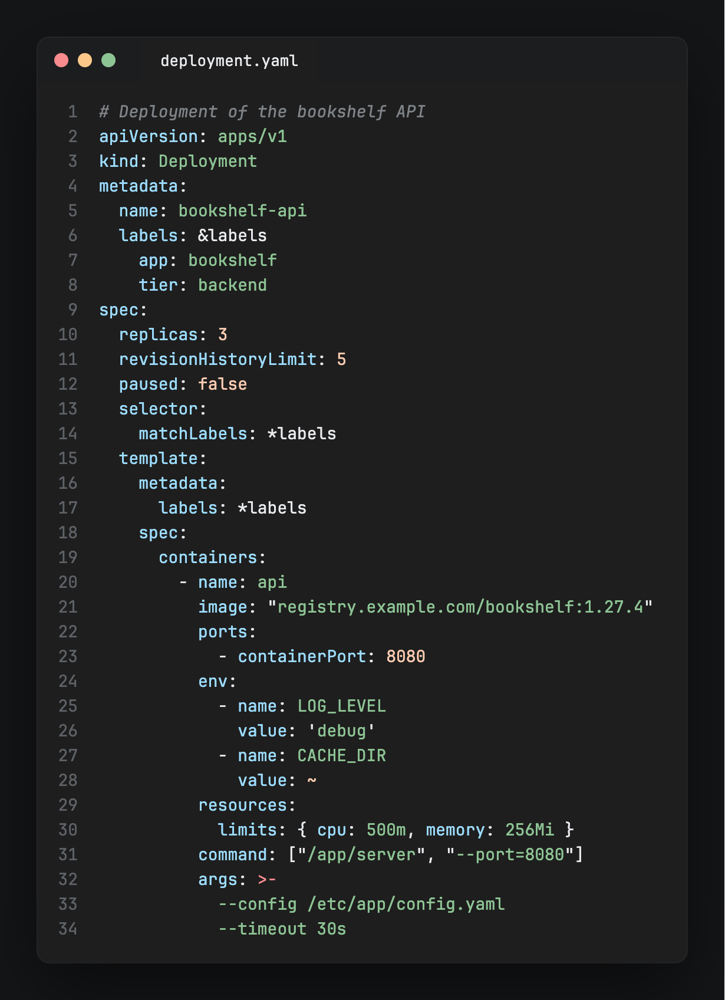
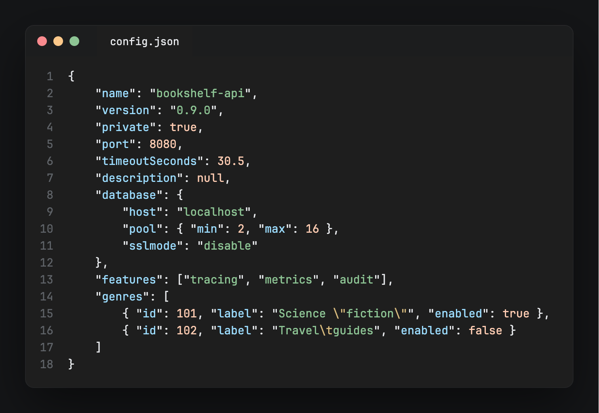

# Dark Relief 🌘 — a calm, pastel dark theme for VS Code

  
  
  
  

<a href="#install">Install</a> · <a href="#whats-new-in-v100">What's new</a> · <a href="#screenshots">Screenshots</a> · <a href="#palette">Palette</a> · <a href="#why">Why</a> · <a href="#how-it-compares">How it compares</a>

Dark Relief keeps everything you know from Dark+, its workbench and its coverage of every language's scopes, and swaps the syntax colours for a small pastel palette on the same neutral grey. Fewer hues, each one easy to tell apart, so code reads calmly for hours.

## Install

- **Marketplace (recommended):** search for "Dark Relief" in the Extensions view, or open the [Marketplace page](https://marketplace.visualstudio.com/items?itemName=asidko.dark-relief).
- **Quick Open:** press `Ctrl+P` / `Cmd+P` and run `ext install asidko.dark-relief`.
- **Manual:** download the `.vsix` from [Releases](https://github.com/asidko/vscode-dark-relief/releases) and run `code --install-extension dark-relief-1.0.0.vsix`.

Then pick it with **Preferences: Color Theme** → **Dark Relief**.

## What's new in v1.0.0

- First release: the Dark+ workbench with a six-hue pastel syntax palette.
- Function names, constants and numbers share one peach; calls, types and property names share one sky blue.
- Variables, parameters and punctuation sit in one quiet near-white, so the coloured roles stand out.
- Number literals stay one colour, prefixes and exponents included (`0x1F`, `1e9`).

## Screenshots

 

## Palette

- Keywords and control flow: `#f98a8e` coral
- Strings: `#8dc494` sage
- Function and method names, constants, numbers: `#feccb2` peach
- Builtin types (`int`, `string`, `error`): `#f2cdcd` blush
- Calls, types, packages, tags and property names: `#9cdcfe` sky
- Format placeholders (`%d`, `%s`): `#fcc88a` apricot
- Variables, parameters, punctuation: `#e8eaed`
- Operators: `#9aa0a6`
- Comments: `#7f8387`, italic
- Editor background: `#1e1e1e`

## Why

Dark+ is the dark theme most of us learned on, and its workbench is hard to beat. Its syntax colours are another story: many mid-tone hues, several of them close to each other, which makes code look busy. Dark Relief keeps the parts that work and changes only what you read:

- Six hues for six roles. Everything that is "just a name" (variables, parameters, punctuation) shares one near-white, so the colour you do see always means something.
- Every syntax colour reaches WCAG AAA (7:1) against the background, except operators (6.3:1) and comments (4.4:1), which are meant to recede.
- Each colour was checked against VS Code's own Go, YAML and JSON grammars, so what you see in the screenshots is what the editor renders.

## How it compares

- [Dark+](https://code.visualstudio.com/docs/getstarted/themes) (built in): the same workbench and scope coverage; Dark Relief replaces its syntax colours with a softer, smaller palette.
- [One Dark Pro](https://marketplace.visualstudio.com/items?itemName=zhuangtongfa.Material-theme): warmer and more saturated on a blue-grey `#282c34`; Dark Relief stays on Dark+'s neutral `#1e1e1e`.
- [Catppuccin Mocha](https://marketplace.visualstudio.com/items?itemName=Catppuccin.catppuccin-vsc): also pastel, with a violet-tinted base and its own workbench; Dark Relief is pastel on neutral grey with the stock Dark+ UI.
- [Night Owl](https://marketplace.visualstudio.com/items?itemName=sdras.night-owl): vivid colours on deep navy, tuned for night coding; Dark Relief is quieter and keeps a grey background.

Dark Relief is deliberately small: one dark variant, no settings, no light theme (yet).

## About the code

This theme is AI-assisted, and the human part is the part that matters: the author decided how it should look and feel, chose every colour, and looked at each change in a real VS Code window before keeping it. Colours were tuned in a separate colour lab that renders code with VS Code's own grammars and flags low contrast and colours that red-green colour-blind readers would confuse. The theme file is plain JSON: the Dark+ rules come first, Dark Relief's named rules are appended last so they win.

CI checks that the theme is valid JSON and that the extension packages on every push; there are no automated visual tests yet. If a token in your language looks wrong, please report it like any other bug.

## Contributing

Bug reports and pull requests are welcome, and the author keeps an eye on the repo. For a wrong colour, include the language, a screenshot, and the scope shown by **Developer: Inspect Editor Tokens and Scopes**.

## License

[MIT](LICENSE). The base rules and workbench colours come from VS Code's Dark+ theme (MIT, Microsoft).
